<p align="right"><sub><strong>ES</strong> · <a href="./README.md">EN</a></sub></p>

<p align="center">
  
</p>

<h3 align="center">Filósofo de la tecnología &amp; Builder</h3>

<p align="center"><strong>Máster Universitario en Filosofía Teórica y Práctica: Lógica, Historia y Filosofía de la Ciencia</strong></p>

<p align="center">Convierto ideas y problemas complejos en herramientas funcionales, guiado por la filosofía KISS — LLMs, IA, interacción humano-IA, privacidad y open source.</p>

<p align="center"> <strong>Disponible para trabajar</strong> ·  <strong>Remoto</strong>: para cualquier empresa del mundo ·  <strong>Reubicación</strong>: a cualquier país</p>

<p align="center"><em>Quiero usar la tecnología, no que la tecnología me use a mí.</em></p>

## `$ cat sobre-mi.md`

Siempre me han interesado la tecnología, los medios de comunicación y la privacidad. Gran parte de mi carrera ha estado dedicada a investigar los avances tecnológicos que la humanidad ha ido incorporando en sus sociedades, y cómo estos la han ido transformando, para bien y para mal. Con el paso de los años y los sucesivos cambios, he aprendido a **usar la tecnología desde ángulos que no estaban previstos**, es decir, usar ese artefacto tecnológico de una nueva forma que sirva como solución ante una dificultad, problema o automatización. Porque las piezas para la solución estaban ahí, pero faltaba montar el puzzle completo para que la solución se hiciese realidad.

Esta idea es una de mis líneas de pensamiento: **se pueden construir soluciones increíbles con pocos recursos** si se sabe utilizarlos correctamente. Al mismo tiempo, esa misma filosofía KISS se traduce en **permitir que el usuario elija lo que quiera**, sin que esa elección le perjudique después. Estas ideas han repercutido en cómo están diseñadas las herramientas que te comparto. Lo hago de este modo porque es exactamente lo que hubiese necesitado cuando era un niño, ya que recuerdo lo que era abrir un programa en un idioma extraño, con una jerga técnica, plagado de opciones y menús, y sentirme abrumado por no saber qué hacer pese a saber que se pueden hacer innumerables cosas.

Ese tipo de impedimentos son los que trato de solventar cuando diseño una solución; el proceso para llegar a ella es lo que más me motiva, pues **disfruto aprendiendo, explorando todo lo que desconozco** y me encanta mejorar lo que ya sé. Eso es justo lo que me guía en la vida. La programación, la IA y la automatización son otro modo que he encontrado para trasladar mis ideas a la realidad; al mismo tiempo, me han dado una actividad placentera en la que puedo pasar muchas horas concentrado.

## `$ ls herramientas/`

###  Mantenimiento del sistema

| &nbsp;&nbsp;&nbsp;&nbsp;&nbsp;&nbsp;&nbsp;Herramienta&nbsp;&nbsp;&nbsp;&nbsp;&nbsp;&nbsp;&nbsp; | Qué hace |
|:---:|:---|
| [<br>**Autostart_Manager**](https://github.com/filonux/Autostart_Manager) | Junta en un panel las apps, servicios systemd y tareas cron que arrancan al iniciar sesión, con más control que Mint de serie. |
| [<br>**Mint-Doctor**](https://github.com/filonux/Mint-Doctor) | Revisa Linux Mint en busca de los problemas más habituales y los repara automáti&shy;camente, bajo tu aprobación en cada paso. |

###  Personalización y multimedia

| &nbsp;&nbsp;&nbsp;&nbsp;&nbsp;&nbsp;&nbsp;Herramienta&nbsp;&nbsp;&nbsp;&nbsp;&nbsp;&nbsp;&nbsp; | Qué hace |
|:---:|:---|
| [<br>**Color-Mint**](https://github.com/filonux/Color-Mint) | Personaliza Cinnamon —temas, panel, escritorio, terminal y fuentes— desde una sola ventana, con copia de seguridad antes de cada cambio. |
| [<br>**PhoneCam**](https://github.com/filonux/PhoneCam) | Usa la cámara y el micrófono de tu Android como webcam y micrófono de Linux por USB — 100% local y sin instalar nada en el móvil. |

###  Copias de seguridad y configuración

| &nbsp;&nbsp;&nbsp;&nbsp;&nbsp;&nbsp;&nbsp;Herramienta&nbsp;&nbsp;&nbsp;&nbsp;&nbsp;&nbsp;&nbsp; | Qué hace |
|:---:|:---|
| [<br>**Mint-Setup**](https://github.com/filonux/Mint-Setup) | Guarda la configura&shy;ción de tu escritorio y tus apps —paneles, temas, Wi-Fi, Docker, LUKS...— y la restaura en una instalación nueva. |
| [<br>**Simple-Backup**](https://github.com/filonux/Simple-Backup) | Copias de seguridad, resincro&shy;nización de carpetas y tareas automati&shy;zadas, todo en un script de Bash. |

###  Seguridad y privacidad

| &nbsp;&nbsp;&nbsp;&nbsp;&nbsp;&nbsp;&nbsp;Herramienta&nbsp;&nbsp;&nbsp;&nbsp;&nbsp;&nbsp;&nbsp; | Qué hace |
|:---:|:---|
| [<br>**Enkripta**](https://github.com/filonux/Enkripta) | Cifra carpetas y archivos con AES-256, integrado en Nemo y el escritorio —doble clic, botón derecho— como parte del sistema. |
| [<br>**Browser-Cleaner**](https://github.com/filonux/Browser-Cleaner) | Limpia 14 navega&shy;dores distintos de la forma más simple, práctica y rápida posible. |
| [<br>**VPN NetGuard**](https://github.com/filonux/VPN-NetGuard) | Kill switch, reconexión automática y anonimato de red para tu VPN en Linux, con instalación en 1 clic. |

###  Gestión de software y archivos

| &nbsp;&nbsp;&nbsp;&nbsp;&nbsp;&nbsp;&nbsp;Herramienta&nbsp;&nbsp;&nbsp;&nbsp;&nbsp;&nbsp;&nbsp; | Qué hace |
|:---:|:---|
| [<br>**MintApp_Remover**](https://github.com/filonux/MintApp_Remover) | Desinstala de forma segura cualquier programa de Linux Mint, también el preinsta&shy;lado, y limpia las depen&shy;dencias huérfanas. |
| [<br>**Renombrador**](https://github.com/filonux/Renombrador) | Renombra archivos y carpetas por lotes, con vista previa y opción de deshacer, desde la terminal o el botón derecho en Nemo. |

###  Desarrollo

| &nbsp;&nbsp;&nbsp;&nbsp;&nbsp;&nbsp;&nbsp;Herramienta&nbsp;&nbsp;&nbsp;&nbsp;&nbsp;&nbsp;&nbsp; | Qué hace |
|:---:|:---|
| [<br>**LinuxMint-Scripter**](https://github.com/filonux/LinuxMint-Scripter) | Web de un solo archivo para generar y auditar scripts de Bash o Python con IA, con tu propia clave de API y sin servidor intermedio. |
| [<br>**Bitácora Dev**](https://github.com/filonux/Bitacora-Dev) | Conserva la historia y el contexto de un proyecto —versiones, decisiones, notas, pendientes— desde el navegador, con IA contextual opcional. |

###  Automatización e integración

| &nbsp;&nbsp;&nbsp;&nbsp;&nbsp;&nbsp;&nbsp;Herramienta&nbsp;&nbsp;&nbsp;&nbsp;&nbsp;&nbsp;&nbsp; | Qué hace |
|:---:|:---|
| [<br>**Scriptya**](https://github.com/filonux/Scriptya) | Convierte cualquier script en una app con icono propio e integración en el menú de Cinnamon o el escritorio. |
| [<br>**Mi-Lanzador**](https://github.com/filonux/Mi-Lanzador) | Secuencias de pasos que abren programas, webs o comandos, colocan ventanas, simulan clics y pulsan teclas — como una macro de Auto&shy;Hotkey. |

## `$ cat stack.txt`

<p align="center">
  
  
  
  
  
  
  
  
</p>

## `$ ./estadisticas.sh`

<p align="center">
  
  
</p>

## `$ ./contacto.sh`

Abierto a roles como `AI Product Engineer`, `Founding AI Engineer` y afines — impacto social de la tecnología, construcción de producto o interacción humano-IA — además de colaboraciones.

`AI Tools` · `Local AI`

<a href="mailto:filonux@proton.me"></a>

```
filonux@nix:~$ _
```
